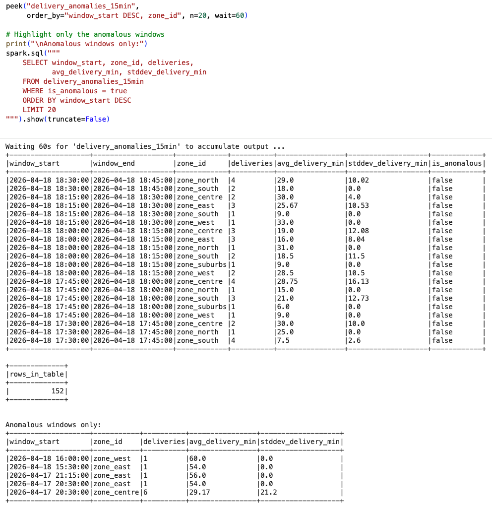
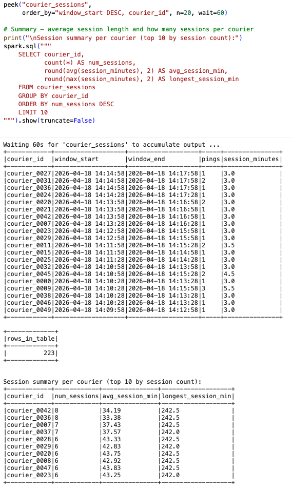

# Real-Time Food Delivery Streaming Analytics

End-to-end streaming analytics pipeline for a simulated food-delivery service: event simulator → Azure Event Hubs → Spark Structured Streaming (analytics + persistence) → Parquet in Azure Blob Storage → Streamlit dashboard.

---

## 1. Architecture at a glance

```
┌─────────────────┐     ┌──────────────────┐     ┌─────────────────────┐
│  generator.py   │────▶│  Azure Event     │────▶│  Spark Structured   │
│  (simulator)    │     │  Hubs            │     │  Streaming (Colab)  │
│                 │     │  · orders topic  │     │                     │
│  Avro payloads  │     │  · couriers topic│     │  · parse Avro       │
│  60× sim time   │     │  4 partitions    │     │  · watermark 10 min │
│  zone_id key    │     │  24 h retention  │     │  · 3 analytics QRs  │
└─────────────────┘     └──────────────────┘     │  · writeStream → Blob│
                                                  └──────────┬──────────┘
                                                             │
                                    ┌────────────────────────┴────┐
                                    ▼                             ▼
                     ┌─────────────────────────┐      ┌──────────────────┐
                     │  Azure Blob Storage     │      │  In-memory tables│
                     │  bronze/                │      │  for analytics QA│
                     │    orders/              │      └──────────────────┘
                     │    couriers/            │
                     │  partitioned by         │
                     │  event_date + zone_id   │
                     └──────────┬──────────────┘
                                │
                                ▼
                     ┌──────────────────────┐
                     │  Streamlit Dashboard │
                     │  · KPIs & time-series│
                     │  · zone filters      │
                     │  · anomaly panel     │
                     └──────────────────────┘
```

**Two topics, one pipeline:** order lifecycle events (ORDER_PLACED → DELIVERED) and courier status pings (AVAILABLE → EN_ROUTE → OFFLINE) are published independently to keep their schemas, sizing, and consumer parallelism independent.

**Three consumers run in parallel** in Colab against the same Event Hubs:

| Consumer | Purpose |
|---|---|
| `consumer_orders.ipynb` | Orders analytics — 3 queries (tumbling / hopping / stream-stream join) |
| `consumer_couriers.ipynb` | Couriers analytics — 3 queries (tumbling / session windows / anomaly) |
| `consumer_blob.ipynb` | Bronze layer sink — raw events → Parquet in Blob |

---

## 2. Repository layout

```
real-time-food-delivery-streaming-analytics/
├── README.md                         ← you are here
│
├── producers/                        ← publish events to Event Hubs
│   ├── generator.py                  ← core simulator (unified stream + batch)
│   ├── producer_orders.ipynb         ← Colab wrapper calling generator.py for orders topic
│   └── producer_couriers.ipynb       ← Colab wrapper calling generator.py for couriers topic
│
├── consumers/                        ← Spark Structured Streaming notebooks
│   ├── consumer_orders.ipynb         ← orders analytics (Q1/Q2/Q3)
│   ├── consumer_couriers.ipynb       ← couriers analytics (Q1/Q2/Q3)
│   └── consumer_blob.ipynb           ← bronze layer persistence
│
├── docs/                             ← design + hand-off documents
│   └── topic_design.md               ← Event Hub topic design rationale
│
├── dashboard/                        ← Streamlit app
│   └── dashboard.ipynb               ← Colab notebook: writes dashboard.py + launches via Cloudflare tunnel
│
├── query_peeks/                      ← screenshots of analytics query outputs
│   ├── consumer_orders/
│   │   ├── consumer_orders_Q1_peek.png
│   │   ├── consumer_orders_Q2_peek.png
│   │   └── consumer_orders_Q3_peek.png
│   └── consumer_couriers/
│       ├── consumer_couriers_Q1_peek.png
│       ├── consumer_couriers_Q2_peek.png
│       └── consumer_couriers_Q3_peek.png
│
└── .gitignore
```

---

## 3. What each component does

### 3.1 Producers

#### `producers/generator.py`

Core event simulator in Python. Generates synthetic food-delivery events with:

- **Realistic demand curves** — lunch peak 12:00–14:00, dinner peak 19:00–21:00, weekend amplification, Friday/Saturday late-night tail
- **Two feeds** — order lifecycle and courier pings, selected with `--feed orders|couriers`
- **Two modes** — `batch` (write to file) or `stream` (publish to Event Hubs via Kafka API)
- **Intentional edge cases** — 8% late events, 4% duplicates, 5% missing PICKED_UP transitions, 3% impossibly long deliveries, 4% couriers going offline mid-delivery (these feed the advanced anomaly queries)
- **Speedup replay** — `--speedup 60` replays a 4-hour simulation in ~4 real minutes against a simulated clock
- **Avro encoding** with `zone_id` as the partition key (enforces zone-locality in Spark)

Run standalone:

```bash
python generator.py stream \
    --namespace iesstsabbadbaa-grp-06-10 \
    --eventhub group_10_orders \
    --conn-str "$PRODUCER_CONN_STR" \
    --feed orders \
    --speedup 60
```

#### `producers/producer_orders.ipynb` · `producers/producer_couriers.ipynb`

Thin Colab wrappers that install dependencies, read the Event Hub producer connection string from Colab Secrets (`PRODUCER_CONN_STR`), and invoke `generator.py` with the right `--feed` and `--eventhub` for that topic. Keeps credentials out of the repo.

### 3.2 Consumers

All three consumers share the same setup pattern: install Java 21 + Spark 4.1 in Colab, load the Event Hub listener connection string from the `CONSUMER_CONN_STR` Colab Secret, connect via the Kafka API with SASL_SSL, decode Avro, flatten into a typed DataFrame.

#### `consumers/consumer_orders.ipynb`

Three analytics queries on the orders topic, each in its own section:

| Query | Tier | Technique | Output table |
|---|---|---|---|
| **Q1** | Basic | 5-min tumbling window, 10-min watermark, `count` + `sum(order_value)` per zone | `orders_per_zone_5min` |
| **Q2** | Intermediate | 10-min hopping window sliding every 5 min, `cancel_rate = cancelled / placed` per zone | `cancel_rate_per_zone_10min` |
| **Q3** | Advanced | Stream-stream join of PICKED_UP ⋈ DELIVERED on order_id with ≤3 h event-time constraint, then rolling μ/σ of delivery duration per 15-min window, flagging zones where avg > 45 min OR stddev > 20 min | `delivery_anomalies_15min` |

#### `consumers/consumer_couriers.ipynb`

Three analytics queries on the couriers topic:

| Query | Tier | Technique | Output table |
|---|---|---|---|
| **Q1** | Basic | 5-min tumbling window, `approx_count_distinct` (HyperLogLog — exact `countDistinct` is not supported on streams), active/available couriers + avg speed + avg battery per zone | `courier_kpis_per_zone_5min` |
| **Q2** | Intermediate | **Session window** with 3-min inactivity gap per courier — detects continuous online sessions and connectivity drops | `courier_sessions` |
| **Q3** | Advanced | 10-min tumbling window over OFFLINE events per zone, flagging zones with ≥3 offline events alongside active deliveries as dispatch issues | `offline_mid_delivery_anomalies` |

#### `consumers/consumer_blob.ipynb`

Streams both topics in parallel to Parquet in Azure Blob Storage — the "data at rest" bronze layer.

- Two independent `writeStream` operators in one Spark session
- 20-second micro-batch trigger (small enough for near-real-time, large enough to avoid tiny-file proliferation)
- Partitioned by `event_date` + `zone_id` so downstream queries can prune
- Append-only output mode — raw events are immutable
- Checkpoints stored in Blob itself, so the stream resumes exactly where it left off after a Colab session restart
- Loads two Colab Secrets: `CONSUMER_CONN_STR` (Event Hubs listener) and `STORAGE_KEY` (Blob account key)

### 3.3 Documentation

#### `docs/topic_design.md`

Design document. Covers:

- Why two topics instead of one multiplexed topic
- Partition count (4 each) and retention (24 h) rationale
- `zone_id` as the partition key and the tradeoffs versus keying on courier_id
- Expected throughput numbers and per-message size
- Consumer group strategy (`groupIdPrefix` per consumer)
- Operational notes — why Snappy compression is disabled (Basic tier of Event Hubs rejects it with `UNSUPPORTED_FOR_MESSAGE_FORMAT`)

#### `dashboard/dashboard.ipynb`

Colab-hosted Streamlit dashboard. The notebook installs `streamlit`, `azure-storage-blob`, and `plotly`, writes a `dashboard.py` file from an inline template, launches Streamlit on localhost:8501, then opens a Cloudflare tunnel (`cloudflared`) that produces a public `https://<random>.trycloudflare.com` URL anyone can open.

Dashboard content:

- **KPI row** — unique orders, total events, active couriers, late events, average order value
- **Time-series** — order events per 10-minute bucket
- **Distributions** — orders by event type (bar), courier status (pie)
- **Telemetry** — speed + battery histograms based on each courier's latest ping
- **Health alerts** — late event rate, duplicate rate, low-battery courier count, with color-coded alerts when thresholds exceeded

Sidebar filters for zone and restaurant cascade across all charts. Data is cached with `@st.cache_data(ttl=30)` so reads are fresh but the Blob isn't hammered on every interaction. See section 4.2 (step 7) for how to run it. Requires the `STORAGE_KEY` Colab Secret, which the notebook passes to the Streamlit process as an environment variable.

### 3.4 Query peeks

`query_peeks/` contains screenshots of each analytics query's output table from a real pipeline run. They prove each query populated real data:

- **consumer_orders Q1:** 287 windows · zone-level revenue and order counts
- **consumer_orders Q2:** 443 windows · cancel rate (example flag: zone_east 66.7%)
- **consumer_orders Q3:** 152 windows · **5 anomalies caught** including zone_centre flagged by stddev=21.2 min
- **consumer_couriers Q1:** 653 windows · courier KPIs per zone
- **consumer_couriers Q2:** 223 sessions · longest 242 min
- **consumer_couriers Q3:** 334 windows · multi-zone dispatch event flagged at 18:00

| Orders – Q3 delivery anomalies | Couriers – Q2 session windows |
|---|---|
|  |  |

---

## 4. How to run the pipeline end-to-end

### 4.1 Prerequisites

- **Azure resources** (already provisioned by instructor):
  - Event Hubs namespace `iesstsabbadbaa-grp-06-10`
  - Two Event Hubs: `group_10_orders`, `group_10_couriers` (4 partitions each, 24 h retention)
  - Shared access policies: `Producer` (Send) and `Consumer` (Listen) at the namespace level
  - Storage account `iesstsabbadbaa` with container `group10output` (created by me)

- **Colab Secrets** (must be added and toggled ON per notebook):
  - `PRODUCER_CONN_STR` — Producer policy connection string (producer notebooks only)
  - `CONSUMER_CONN_STR` — Consumer policy connection string (consumer notebooks only)
  - `STORAGE_KEY` — Storage account access key (blob consumer notebook AND dashboard notebook)

### 4.2 Run order

Because consumers subscribe to Event Hubs with `startingOffsets: earliest`, they will replay any events still within the 24 h retention window. The order below is the recommended sequence for a clean end-to-end demo run:

1. **Start the blob consumer** first (`consumer_blob.ipynb`) — run all cells up to and including the two `start()` calls. Both writeStreams are now waiting for data.

2. **Start the orders producer** (`producer_orders.ipynb`) — run the "Real" cell. Events begin flowing to Event Hubs.

3. **Start the couriers producer** (`producer_couriers.ipynb`) — same approach. Both topics now have events flowing.

4. **Run the orders consumer** (`consumer_orders.ipynb`) — all cells top to bottom. The three analytics queries start and populate their in-memory tables.

5. **Run the couriers consumer** (`consumer_couriers.ipynb`) — same.

6. **Verify blob output** — back in `consumer_blob.ipynb`, run Section 10 to read the Parquet back and confirm counts.

7. **Launch the Streamlit dashboard** — open `dashboard/dashboard.ipynb` in Colab, run all cells. The final cell prints a Cloudflare tunnel URL; open it in any browser to see the live dashboard reading from Blob.

### 4.3 Expected numbers

From a complete 4-hour simulated run (producers at `--speedup 60`, ~4 real minutes each):

- ~1,200 order events published to `group_10_orders`
- ~25,000 courier events published to `group_10_couriers`
- ~2,400 order events persisted as Parquet (across multiple runs)
- ~50,000 courier events persisted as Parquet

---

## 5. Key engineering decisions (lessons learned)

**Snappy compression disabled.** Event Hubs Basic tier rejects client-side compressed messages with `UNSUPPORTED_FOR_MESSAGE_FORMAT`. The producer runs uncompressed.

**`approx_count_distinct` instead of exact `countDistinct`.** Spark Structured Streaming does not support exact distinct counts on streaming aggregates. I switched to HyperLogLog-based approximation for the couriers KPI query.

**Watermark of 10 minutes.** Balances state-store size (bounded by the watermark) against accepting genuinely late events. Late events beyond 10 min are dropped; in the synthetic data this is acceptable because 96% of late events arrive within the window.

**`zone_id` as partition key, not courier_id.** Zone-level analytics are the dominant pattern (all six queries group by `zone_id`). Keying on zone means Spark handles per-zone state on a single executor with no shuffle for the windowed aggregates.

**Dual timestamps in every event.** `event_time` (when the event "happened" in the simulated world) and `ingestion_time` (when the producer handed it to Event Hubs). This allows both watermarking correctly on event time AND measuring ingestion latency.

**Advanced courier query pivot.** My original Q3 filter (`status = 'OFFLINE' AND order_id IS NOT NULL`) matched zero rows because the generator nulls `order_id` at the same moment it sets status to OFFLINE. I pivoted to a zone-level heuristic (≥3 OFFLINE events in a 10-min window with active deliveries) which captures the same operational signal — a real lesson in how generator semantics shape query design.

---

## 6. What's intentionally NOT in this repo

- **Connection strings and account keys.** Loaded from Colab Secrets (notebooks) and environment variables (Streamlit app) at runtime. Never committed.
- **Parquet data files.** Generated at runtime into Azure Blob, not checked into git.
- **Spark and Java binaries.** Installed fresh in each Colab session (first cells of every consumer notebook).
- **`__MACOSX` junk files and `.DS_Store` noise.** Filtered by `.gitignore`.

---
